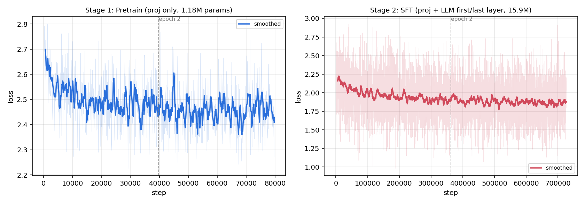

# VLM 复现、微调与强化学习实验记录

三组视觉语言模型（VLM）实验的完整脚本、训练日志与分析结论。

- **实验一**：复现 LLaVA 范式的轻量级 VLM（基于 [minimind-v](https://github.com/jingyaogong/minimind-v)），完成两阶段训练、特征融合的向量化改写与 POPE 幻觉评测。
- **实验二**：基于 [ms-swift](https://github.com/modelscope/ms-swift) 对 Qwen3-VL-8B 做手写公式识别（LaTeX-OCR）的 LoRA 微调，含数据泄漏审计、rank 消融与冻结策略消融。
- **实验三**：在实验二基础上做 GRPO 强化微调（RLVR），并用对照实验定位其收益的真实来源。

> 本仓库存放的是**实验脚本、日志与分析**，模型实现来自上述开源项目，版权归原作者。
> 硬件：NVIDIA H20（共用集群，1–2 卡），bf16 + DDP。

---

## 七个主要发现

### 1. 数据集重复采样导致验证集 100% 泄漏

`dataset_id#N` 在数据量不足 N 时会**重复采样补足，且重复发生在切分验证集之前**，同一样本的副本因此同时落入训练集与验证集。

```
LaTeX_OCR:human_handwrite  →  1,338 行，仅 295 条唯一公式
指定 #20000  →  重复 15 倍得到 19,934 行  →  再按 5% 切分
结果：验证集 23 条唯一公式，100% 出现在训练集中
```

泄漏数据上测得整串正确率 47.0% → 86.4%；换用去重后的干净数据重测，真实提升为 2.0% → 7.6%。
审计脚本 [`check_leakage.py`](part2_qwen3vl_lora/scripts/check_leakage.py)，修复方案 [`prep_clean.py`](part2_qwen3vl_lora/scripts/prep_clean.py)（**先去重 → 再打乱 → 最后切分**）。

### 2. 瓶颈在视觉编码器，而非语言模型

残余误差集中于符号误识（手写 `δ` 被判为 `S`）。据此假设瓶颈在感知侧并设计对照——同等数据与轮数下解冻视觉塔：

独立测试集（500 条，与训练集/验证集公式零重叠）：

| 配置 | 轮数 | 整串正确率 | 字符准确率 | 字符错误率 | ≥90%相似 |
|---|---|---|---|---|---|
| 未微调基线 | — | 2.4% | 68.96% | 31.04% | 26.2% |
| 冻结 ViT | 3 | 8.0% | 80.25% | 19.75% | 48.4% |
| **解冻 ViT** | **3** | **10.8%** | **81.77%** | **18.23%** | **54.2%** |

**同等 3 epoch 下，解冻视觉塔的整串正确率相对提升 35%（8.0% → 10.8%）**；验证集上解冻训练 1 轮即优于冻结训练 3 轮。
语言侧的额外训练与强化学习均无法突破的上限，解冻视觉塔一次性突破，证实瓶颈在感知侧。

### 3. 领域适配的代价：跨分布性能崩溃，且与视觉塔是否解冻无关

以同一数据集中另一来源（`human_handwrite`，真人手写，295 条，训练从未接触）构建跨分布测试集：

| 模型 | 整串正确率 | CER（严格） | CER（宽松） |
|---|---|---|---|
| 基线（未微调） | **58.3%** | **12.41%** | **8.26%** |
| 冻结 ViT 1 epoch | 34.6% | 66.60% | — |
| 冻结 ViT 3 epoch | 13.2% | **188.93%** | — |
| 解冻 ViT 3 epoch | 11.9% | 146.22% | 77.41% |

**失败模式**：输出长度由平均 23.5 字符膨胀至 54.9 字符（2.4 倍），37% 的样本超出答案长度两倍；
模型将训练分布的论文排版习惯（`\;` 间距、`\left(`、`\mathrm{}`）套用到简单算式上，并出现符号幻觉（数字 `2` 识别为 `lpha`）。

**混淆因素控制**：OOD 公式平均 23.2 字符、同分布 101.9 字符，长度差异显著。为排除"模型只是不适应短公式"这一解释，
取同分布测试集中最短 25%（平均 41 字符）单独评测——基线 CER 40.77%、微调后 20.97%，模型仍大幅占优，
故崩溃成因锁定于**视觉分布迁移**而非公式长度。

**关键结论**：冻结视觉塔的版本恶化更严重（188.9% vs 146.2%），即灾难性遗忘源于 **SFT 本身**而非视觉塔解冻，
且随训练轮数单调递增（1 epoch 66.6% → 3 epoch 188.9%）。这与"解冻视觉塔会破坏通用表征"的常见担忧相反。

> 因此本项目的准确定位是**领域适配（domain adaptation）**而非"模型优化"：以通用能力换取目标分布性能。
> LoRA 旁路可插拔、基座权重未被修改，实际部署可按任务加载或卸载适配器。

### 4. GRPO 的收益取决于推理协议，而非能力提升

训练奖励由 0.775 收敛至 0.857，但贪心解码下的下游指标几乎不变。为区分"泛化失败"与"评测协议错配"，设计 2×2 对照：

| 数据集 | 协议 | SFT | GRPO | 变化 |
|---|---|---|---|---|
| 训练集 | 贪心 | 90.29% | 90.30% | +0.01 |
| 训练集 | 采样 | 89.41% | 89.50% | +0.09 |
| 验证集 | 贪心 | 84.96% | 85.19% | +0.23 |
| **验证集** | **采样** | **82.78%** | **84.57%** | **+1.80** |

结论：GRPO 并未提升能力上限，而是**消除了采样带来的额外误差**——验证集上采样相对贪心的性能惩罚由 2.77pt 降至 0（字符准确率口径下采样协议 +3.05pt）。
决定性证据：**奖励收敛值 0.857 ≈ SFT 原有的贪心水平 0.850**，即奖励涨幅恰好等于补回采样损失。

### 5. 验证 loss 最优的 checkpoint 不是下游指标最优的

| 实验 | eval loss 最低处 | 下游指标最优处 |
|---|---|---|
| 冻结 ViT 3ep | 第 1200 步（0.1594） | 第 1875 步（7.6%） |
| 解冻 ViT 3ep | 第 1200 步（0.1486） | 第 1875 步（12.2%） |

解冻 ViT 实验中，验证 loss 于 64% 训练进度触底后回升至 0.1551，但下游整串正确率从 10.8% 一路升至 12.2%。**若按 loss 早停将损失 1.4pt。**

eval loss 是 teacher forcing 下的逐 token 交叉熵，下游指标是自回归生成后整串比对，两者可以背离。**选 checkpoint 必须用下游指标实测。**

### 6. 评测协议会翻转"幻觉偏置"的方向

在 POPE 基准（900 条物体存在性判断）上对 minimind-v 做两种协议的评测：

| 协议 | 准确率 | yes 回答占比 |
|---|---|---|
| 自由生成后解析 | 48.3–53.0% | 21% |
| 强制二选一（比较 Yes/No logit） | 48.7–50.3% | **95%** |

同一模型、同一批数据，yes 占比从 21% 翻转到 95%，**而准确率始终停在 50% 的随机水平**。
说明该模型不具备物体存在性判别能力，所谓"偏置方向"完全是评测协议的产物。

### 7. 图像特征融合的向量化改写：端到端提速 40%

原实现按样本逐 token 扫描占位符并用 `torch.cat` 重建张量；改为基于 mask 的批量 `masked_scatter`：

| 指标 | 原实现 | 向量化 | 提升 |
|---|---|---|---|
| 函数级耗时 | 9.966 ms | 0.234 ms | **42.6×** |
| 端到端单步训练 | 0.301 s | 0.181 s | **−40%** |

正确性：4 组不同 batch / 序列长度 / 图数配置逐元素比对，**最大差异 0.00e+00**；保留原实现作为不规则输入的回退路径。
补丁 [`count_vision_proj_vectorize.diff`](part1_minimind_v/patch/count_vision_proj_vectorize.diff)，基准脚本 [`bench_vision_proj.py`](part1_minimind_v/scripts/bench_vision_proj.py)。

---

## 实验一：minimind-v 两阶段训练

| | Pretrain（图文对齐） | SFT（指令微调） |
|---|---|---|
| 可训练参数 | 1.183M（1.8%，仅投影层） | 15.932M（24%，投影层 + LLM 首尾层） |
| 学习率 | 4e-4 | 5e-6 |
| 数据 | 127 万 caption | 290 万（问答 140 万 + caption 127 万 + 纯文本 23 万） |
| 耗时 | 1 小时 38 分 | 10 小时 8 分 |
| loss | 2.570 → 2.462 | 2.077 → 1.859 |



**观察**：Pretrain 阶段 loss 在前 20% 即收敛饱和（后 80% 仅降低不到 1%），因可训练参数仅 1.18M、模型容量早早到顶；SFT 阶段参数扩大 13 倍后 loss 全程稳定下降。该任务上 Pretrain 跑满 2 epoch 属算力冗余。

## 实验二：Qwen3-VL-8B LoRA 微调

任务：手写公式识别（LaTeX-OCR，synthetic_handwrite 子集去重后训练 20,000 / 验证 500，重叠 0）。
配置：LoRA rank=16、alpha=32，可训练参数 43.6M（占 8.77B 的 0.5%）；有效 batch 32。

### 完整指标（验证集 500 条）

**数据三分**：训练 20,000 / 验证 500（监控 loss、选 checkpoint）/ 测试 500（仅最终报告，零重叠）。

验证集（用于 checkpoint 选型）：

| 模型 | 整串正确 | 字符准确率 | 字符错误率 | 相似度 | ≥90%相似 |
|---|---|---|---|---|---|
| 基线（未微调） | 2.0% | 67.42% | 32.58% | 77.07% | 23.0% |
| LoRA 1 epoch | 6.6% | 76.53% | 23.47% | 83.58% | 45.8% |
| LoRA 3 epoch | 7.6% | 78.18% | 21.82% | 85.04% | 50.0% |
| 解冻 ViT 1 epoch | 9.0% | 77.94% | 22.06% | 85.92% | 51.8% |
| **解冻 ViT 3 epoch** | **12.2%** | **81.20%** | **18.80%** | **87.42%** | **56.6%** |

独立测试集（最终报告口径）：

| 模型 | 整串正确 | 字符准确率 | 字符错误率 | 相似度 | ≥90%相似 |
|---|---|---|---|---|---|
| 基线（未微调） | 2.4% | 68.96% | 31.04% | 77.61% | 26.2% |
| 冻结 ViT 3 epoch | 8.0% | 80.25% | 19.75% | 85.52% | 48.4% |
| **解冻 ViT 3 epoch** | **10.8%** | **81.77%** | **18.23%** | **86.97%** | **54.2%** |

**选择偏差量化**：最终模型在验证集上 12.2%、测试集上 10.8%，差 1.4pt——即"在验证集上选 checkpoint、又用验证集报分"带来的乐观偏差。基线与冻结版在测试集上反而各高 0.4pt，说明该差异来自选型而非数据难度。

> 标签平均长度 108 字符（最长 819），整串正确要求一字不差，单符号错误即判负，故以**字符错误率**与**≥90% 相似占比**为主要指标。

**跨分布表现见发现 3**：上述提升仅在目标分布成立，换用真人手写样本后模型显著劣于基线。

### rank 消融

验证 loss 随秩单调改善（0.1788 / 0.1729 / 0.1668），但下游指标趋于饱和（相似度 83.24 / 83.58 / 83.80），显存 44.6 / 45.1 / 45.4 GB。**该任务上 rank 16 已足够。**

## 实验三：GRPO 强化微调（RLVR）

从 SFT checkpoint 继续训练，4 路 rollout、KL 系数 0.04、学习率 1e-6，2000 条 prompt / 500 步，单卡 21GB。

**奖励设计**：直接以评测指标（归一化字符相似度）作为可验证奖励，无需训练奖励模型。选用连续相似度而非 0/1 精确匹配，以缓解奖励稀疏——该任务精确匹配率仅 7.6%，0/1 奖励下绝大多数采样得零分，组内标准差趋零、优势函数退化为噪声。

**奖励函数诊断**：格式奖励全程标准差趋近 0，即所有采样同分；GRPO 依赖组内相对优势，常数项在归一化后被完全抵消，**该奖励项实际零贡献**。结论：奖励函数的价值在于**区分度**而非合理性。

---

## 目录结构

```
part1_minimind_v/
├── scripts/   环境安装、数据下载、训练启动、向量化基准、POPE 评测（两种协议）
├── patch/     count_vision_proj 向量化改写的 diff
└── results/   两阶段 loss 记录与曲线图、POPE 结果
part2_qwen3vl_lora/
├── scripts/   环境搭建、干净数据集构建、rank 消融、3 epoch 训练、解冻 ViT 训练、
│              泄漏审计、评测指标计算、checkpoint 挑选、独立测试集与跨分布(OOD)评测
└── results/   各组训练日志（logging.jsonl）与指标汇总
part3_grpo/
├── scripts/   奖励函数插件、GRPO 数据构建与训练、2×2 对照实验与指标计算
└── results/   GRPO 训练日志
docs/          数据泄漏事件完整复盘
```

## 复现

```bash
# 实验一
bash part1_minimind_v/scripts/install_env.sh
bash part1_minimind_v/scripts/download_data.sh
bash part1_minimind_v/scripts/run_train.sh
python part1_minimind_v/scripts/eval_pope.py --n_per_cat 300

# 实验二
bash part2_qwen3vl_lora/scripts/setup_swift.sh
python part2_qwen3vl_lora/scripts/prep_clean.py      # 构建零泄漏数据集
bash part2_qwen3vl_lora/scripts/run_ablation.sh      # rank 8/16/32
bash part2_qwen3vl_lora/scripts/run_vit_unfrozen.sh  # 解冻视觉塔
python part2_qwen3vl_lora/scripts/full_metrics.py

# 实验三
python part3_grpo/scripts/prep_grpo.py
bash part3_grpo/scripts/run_grpo.sh
bash part3_grpo/scripts/run_2x2_probe.sh             # 区分泛化失败与协议错配
```

脚本中的路径为实验环境的绝对路径，复现时需按实际情况调整。
